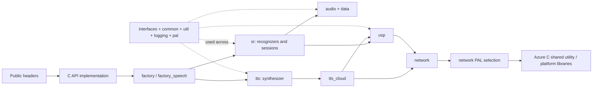
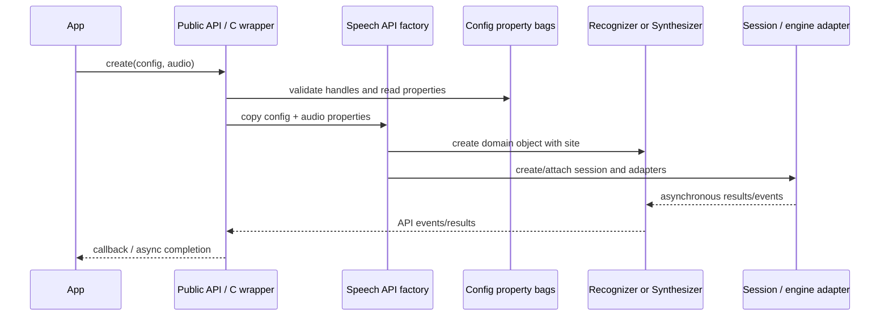

# 1. System architecture

## What this repository builds

The root CMake project assembles a cross-platform native speech SDK. The public-facing headers live under `source/public`; implementations are divided into static/object libraries under `source/core`. CMake target names are useful architectural clues: `interfaces`, `common`, `audio`, `data`, `networking`, `usp`, `sr`, `tts`, `tts_cloud`, and factory/API layers.

The project has a core-only build mode. The source-level CMake conditionally includes `extensions`, `templates`, `mock`, and `tts_mock` where those directories/features exist. This checkout contains only source/core and source/public, and the root project detects core-only mode when bindings/extensions are absent. That build mode and the root README's supported-scope statements matter: an implementation existing in a source folder does not automatically mean every SDK feature or platform backend is available in this distribution.

## Main layers

| Layer | Responsibility | Representative locations |
|---|---|---|
| Public API | User-facing C++ classes, configs, result and event types | `source/public/cxx_api`, `source/public/c_api` |
| API bridge | C-compatible functions, opaque handle validation/tracking, error conversion, callback adaptation | `source/core/c_api`, `source/core/shared_c_api` |
| Object creation | Select and construct recognizers, synthesizers, sessions and platform modules | `source/core/factory`, `source/core/factory_speech`, domain factory files |
| Speech domains | Recognition/session orchestration, synthesis, meetings/transcription/dialog | `source/core/sr`, `source/core/tts`, `source/core/tts_cloud` |
| Media/data | Audio input/output abstractions, pumps, codecs, bounded streaming buffers | `source/core/audio`, `source/core/data` |
| Protocol/network | USP messages and connection state over WebSocket; HTTP/WebSocket abstractions and platform adapters | `source/core/usp`, `source/core/network` |
| Shared runtime | Interfaces/sites, properties, async/thread services, errors, utilities, logging, PAL | `source/core/interfaces`, `common`, `util`, `logging`, `pal` |
| Dependencies | Platform transport implementation and utility code | `source/core/external` |

## Dependency sketch

This is a conceptual dependency view, not a complete linker graph. Individual CMake target declarations are authoritative for a particular build/platform. In particular, `network/pal` selects among Azure C Shared, Azure Core, or no-network implementations through `NATIVE_NETWORKING_IMPL`.

## Object composition and properties

The code uses interface-oriented C++ components, shared ownership, and a site/service-provider pattern. Factories assemble objects and attach sites; sites expose shared services and parent properties. Property bags carry configuration across the C API, factory, recognizer/session, and adapter layers. Factory creation commonly copies properties from speech configuration and audio configuration into factory properties before constructing the domain object.

Typical composition:

### Patterns to recognize

- **Interface and site composition:** public/domain implementations query interfaces and services rather than wiring concrete classes everywhere. Inspect `source/core/interfaces/include/ispxinterfaces.h`, `common/include/service_helpers.h`, and `common/include/site_helpers.h`.
- **Module factories:** named module objects are created through module/factory helpers, with platform or feature-specific implementations selected by the build.
- **Shared property bags:** configs, factory and domain objects share/copy named properties; settings often travel through this channel into endpoint construction and engines.
- **Async operation wrappers:** `CSpxAsyncOp` and helper functions bridge futures/promises, callbacks and synchronous wait APIs.
- **C API handles:** opaque public handles are tracked to shared C++ objects; validate and release paths live in the C API implementation and common handle helpers.

## Domain map

- **Recognition:** recognizer façade + audio stream session + recognition adapter; covers one-shot and continuous operations, translation, language detection, transcription, and related result/event plumbing. See [recognition](04-recognition.md).
- **Audio:** source and sink configurations, pull/push streams, pumps, buffering, file I/O, and platform codec adapters. See [audio](03-audio.md).
- **USP:** protocol message construction/parsing, request/turn IDs, audio framing, server event dispatch, metrics, and WebSocket transport. See [USP/networking](05-usp-and-networking.md).
- **Synthesis:** public synthesizer + orchestration + selected engine adapter; output streaming and metadata events. See [synthesis](06-synthesis.md).
- **Shared runtime:** contracts and services supporting these domains, not itself a speech engine. See [shared core services](07-shared-services.md).

## Architecture boundaries and caveats

1. `source/core/sr` is not one recognizer algorithm: it orchestrates speech sessions and adapters. `CSpxUspRecoEngineAdapter` bridges recognition to USP; related classes handle retry/hybrid output and event adaptation.
2. `source/core/usp` is protocol/session transport logic, not the low-level socket or TLS implementation. It delegates through `source/core/network` and selected PALs.
3. `source/core/tts` coordinates output and events; cloud request/protocol implementations are under `source/core/tts_cloud`, while local/mock adapters may be supplied by extension/conditional build components.
4. The source tree includes C ABI bridge code, but the repository's README describes the supported source/API offering as C++ only. Keep that distinction explicit.
5. Platform-specific codec/device functionality is conditional, and the README excludes some extension-dependent functions in this distribution.

## Best entry points

- Build composition: root `CMakeLists.txt`, `source/CMakeLists.txt`, `source/core/CMakeLists.txt`.
- Public API catalogue: `source/public/cxx_api` and its headers such as `speechapi_cxx_speech_recognizer.h`, `speechapi_cxx_speech_synthesizer.h`, `speechapi_cxx_audio_config.h`.
- Creation path: `source/core/c_api/speechapi_c_factory.cpp` and `source/core/sr/speech_api_factory.cpp`.
- Runtime core: `source/core/sr/audio_stream_session.cpp`, `source/core/tts/synthesizer.cpp`, `source/core/usp/usp_connection.cpp`.
