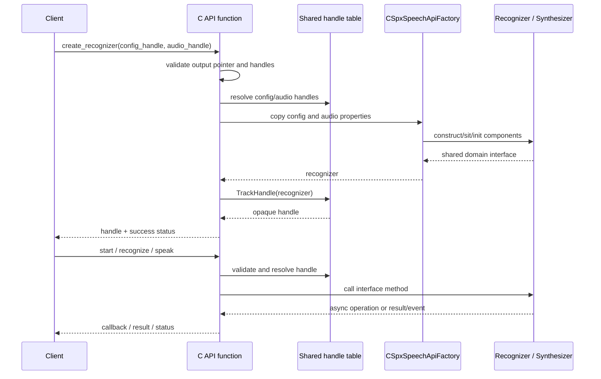
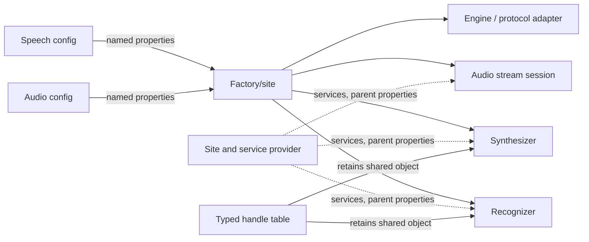

# 2. API boundary and object lifecycle

## Public surface

`source/public/cxx_api` contains the SDK's public C++ classes, enums, configs, streams, recognizers, synthesizers, results, and event arguments. `source/public/c_api` contains C declarations. The implementations that bind these declarations to internal C++ objects are in `source/core/c_api`; shared C support helpers are in `source/core/shared_c_api`.

The root README describes this open-source source offering as having C++ source and APIs available, and explicitly limits feature support. C declarations/wrappers in the repository should therefore be read as implementation material, not as a promise that this source drop supports all public bindings or extension features.

## C ABI to C++ object path

The C API uses opaque handles. The C wrapper checks argument validity and handle validity, obtains the underlying shared object from handle tables, invokes its C++ interface, then tracks a newly-created object under a public handle. C++ public API objects often call the same internal implementation directly through shared pointers and interfaces.

### Key implementation files

- `source/core/c_api/speechapi_c_factory.cpp` — helper paths for recognizer, translation, dialog, meeting, and synthesizer creation.
- `source/core/c_api/speechapi_c_recognizer.cpp`, `speechapi_c_synthesizer.cpp` — operation, async-wait, event callback and result accessors.
- `source/core/c_api/speechapi_c_audio_config.cpp`, `speechapi_c_audio_stream.cpp` — audio config and stream construction/use.
- `source/core/common/include/handle_helpers.h`, `handle_table.h` — shared handle lookup, tracking, interface querying, and release helpers.
- `source/core/c_api/event_helpers.cpp` and `binding_callback_storage.h` — callback registration and callback lifetime support.
- `source/core/shared_c_api` — common C ABI error/property/diagnostic helpers.

## Config, factory, and site lifecycle

Creation is more than `new`:

1. The wrapper resolves configuration and audio handles.
2. It copies named properties into a factory property bag. The API factory maps requested kind/config to an internal class and attaches relevant components.
3. The factory initializes/configures audio input/output and creates the session or synthesis backend.
4. The domain object receives a site. That site can expose parent properties and services such as thread execution, event-argument creation, network platform and telemetry.
5. The C API stores a shared pointer in a typed handle table. Releasing the public handle stops tracking; domain-specific teardown and shared ownership determine final destruction.

Sites/property bags are important to understand configuration propagation. For instance, the C API factory copies speech and audio config property bags; the recognizer stores its default session; and the synthesizer retains its site while async tasks/adapters can need access to properties.

## Events and async methods

Internally, async operations are represented using the SDK's `CSpxAsyncOp` and task helpers. Public operations can be async, synchronously waited on, or event-driven. Event signals are adapted to C callback registration functions in `event_helpers.cpp`; the underlying session/synthesizer generally creates event argument objects and dispatches them using a thread service.

Important lifecycle questions when changing API plumbing:

- Who owns the object after a handle is released?
- Can queued callbacks still reference the object or user callback storage?
- Does event registration need to be disconnected before destroying state?
- Which property bag is authoritative when configurations are copied or shared?
- Are C error codes and internal exceptions converted at the correct boundary?

## Error translation

Internal code uses exceptions/error information and status/result objects. C wrappers use `SPXAPI_TRY`-family macros and common error helpers to turn exceptions into HRESULT-like `SPX` status values. Recognition cancellation details flow through error-information/result properties. Avoid leaking raw implementation or sensitive service data in public errors; follow existing conversions.

## How to trace an API addition

1. Locate its public declaration in `source/public/cxx_api` (and C declaration if applicable).
2. Find its C wrapper in `source/core/c_api` or its concrete C++ implementation under `sr`, `tts`, `audio`, etc.
3. Trace construction from `speechapi_c_factory.cpp` into `speech_api_factory.cpp` / synthesis factory.
4. Inspect the corresponding interface in `source/core/interfaces/include/interfaces`.
5. Confirm handle ownership, callback registration/unregistration, async operation, result lifetime, property propagation, and error conversion.
6. Check conditional feature/platform support in CMake and the repository README.
