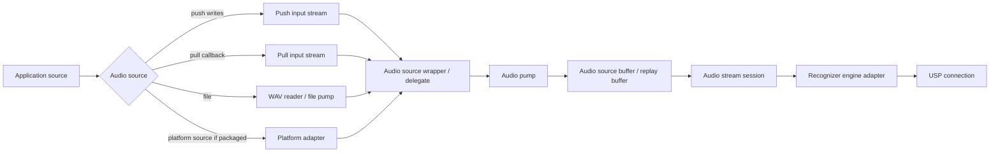
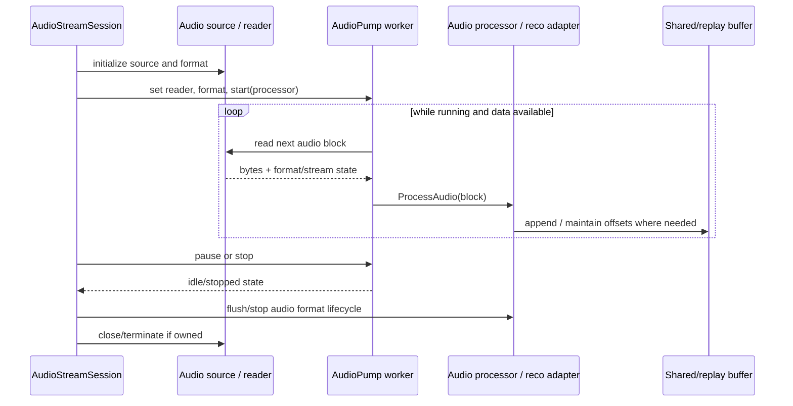
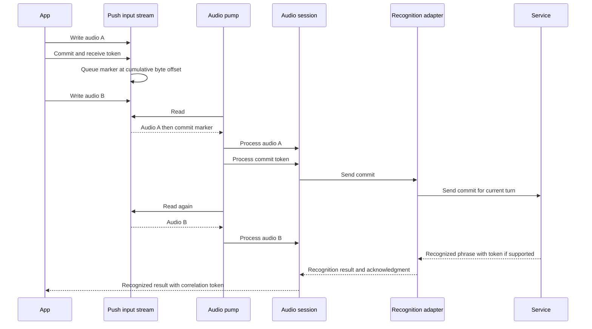
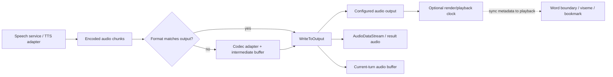

# 3. Audio subsystem

## Responsibilities and boundaries

Audio code turns an application or platform source into a paced byte stream suitable for speech processing, and routes synthesized/output bytes to application or platform sinks. It provides reusable stream interfaces and file/buffer implementations; it is not the recognition protocol itself.

Primary locations:

- `source/core/audio` — audio config, audio source wrapper, streams, audio pump, WAV reader/writer, codec adapters, processing options.
- `source/core/data` — ring buffers and buffer properties.
- `source/core/common/include/audio_source_*` — reusable control/pump/source helpers.
- `source/core/sr/audio_stream_session.cpp` — connects source/pump data into recognition processing.
- `source/core/tts/synthesizer.cpp` — routes synthesized data to output and data streams.

The root README explicitly excludes direct audio-device access, compressed input audio, and Microsoft Audio Stack processing from this open-source offering because those rely on official extension packages. The source tree still contains abstractions and conditional/platform adapters; availability depends on build/product packaging.

## Audio abstractions

- **Audio config (`CSpxAudioConfig`):** describes/defaults the selected input or output source and associated properties.
- **Push input:** application writes buffers into `CSpxPushAudioInputStream`; consumers read them asynchronously. It supports end-of-stream and, in SDK 1.52.0, preview `Commit()` boundaries (optionally channel-scoped) for supported uncompressed formats. Commits are ordered with audio, rate-limited locally, and correlated with recognized results by token; service support is not guaranteed. See [commit flow](#push-stream-commit-flow).
- **Pull input:** SDK calls an application-provided reader callback through `CSpxPullAudioInputStream`.
- **Push output:** SDK calls application writer callbacks through `CSpxPushAudioOutputStream`.
- **Pull output:** application reads buffered SDK output from `CSpxPullAudioOutputStream`.
- **Audio data stream:** seekable/readable synthesis or recognition-result audio stream (`CSpxAudioDataStream`).
- **Audio pump:** background worker that reads chunks from an `ISpxAudioStreamReader`, applies/coordinates processing, and forwards audio to a processor.
- **Buffering:** `CSpxBufferData` and `CSpxReadWriteRingBuffer` support bounded/replay/multi-reader access; `CSpxBlockingReadWriteBuffer` adds wait-for-data/space semantics.
- **File/WAV:** WAV parsing, pumping, writing and save-to-wave helpers provide file workflows.
- **Codec adapters:** optional platform codecs exist for Android/Apple; internal codec paths are build dependent.

## Input path: source to recognition

### Typical pump lifecycle

This represents the normal conceptual flow. Some session paths may set audio format, replay audio, throttle based on acknowledged audio, or hot-swap adapters while paused; see `audio_stream_session.cpp` methods such as `ProcessAudio`, `ProcessNextAudio`, `StartAudioPump`, adapter hot-swap helpers, and audio offset/replay-buffer functions.

## Push-stream commit flow

SDK 1.52.0 adds preview `PushAudioInputStream::Commit()` and `Commit(channelId)` methods. A commit marks the byte boundary after audio already written; it does not itself end the audio stream. The SDK queues the marker inline with audio so its ordering is preserved. The audio pump forwards preceding audio first and then the commit through the recognition adapter; a later service acknowledgment may correlate with a `Recognized` result using the token. The API documents that a returned token does not guarantee an acknowledgment. Commits are rate-limited, have format/session constraints, and may be dropped when unsupported or undeliverable.

The implementation handles ordering, replay on reconnect and multichannel acknowledgment bookkeeping in `source/core/audio/push_audio_input_stream.cpp`, `source/core/audio/audio_pump.cpp`, `source/core/sr/audio_stream_session.cpp`, and the recognition adapter. It rejects commits for formats routed through unsupported codec/passthrough paths; see the public API remarks in `source/public/cxx_api/speechapi_cxx_audio_stream.h`. `Commit()` availability in source is not a guarantee that every service endpoint supports the feature.

## Output path: synthesis to consumer

`CSpxSynthesizer` writes incoming audio chunks to an internal pull stream, an `ISpxAudioDataStream`, and the configured output sink. If the backend audio format differs from requested output, a codec adapter may decode/transcode before `WriteToOutput` sends bytes to the consumer. The output can be a push callback, pull stream, or configured platform sink.

## Concurrency and buffering considerations

- Push/pull streams can block/wait and signal closure/end-of-stream; don't assume every read is a complete frame or that close implies no queued bytes.
- Ring buffers expose absolute byte/time offsets, capacity and overflow behavior. Replay and continuation offsets are distinct from transient buffer positions.
- Pump start/pause/stop is a stateful worker operation. Session shutdown must synchronize with worker termination before destroying objects called from the worker.
- Audio callback code should avoid doing blocking work on latency-sensitive threads unless existing behavior requires it.
- Recognition throttling can depend on service acknowledgement and buffer size. Speech session delegates process acknowledged offsets back into throttling/replay control.
- Synthesis may separately retain raw result audio and write audio to a configured output; errors from the output write can be reflected in the result even after service synthesis succeeded.

## Code landmarks

- Source abstractions: `audio/audio_config.*`, `audio/audio_source_wrapper.*`, `audio/push_audio_input_stream.*`, `audio/pull_audio_input_stream.*`.
- Pump: `audio/audio_pump.*`, plus common `audio_source_control_adapts_audio_pump_impl.h`.
- Buffers: `data/buffer_data.*`, `data/read_write_ring_buffer.*`, `data/blocking_read_write_buffer.h`.
- Files: `audio/wav_file_reader.*`, `wav_file_writer.*`, `wav_file_pump.*`.
- Output/data stream: `audio/pull_audio_output_stream.*`, `push_audio_output_stream.*`, `audio_data_stream.*`.
- Codec: `audio/internal_audio_codec_adapter.*`, `audio/codec/android_codec_adapter.*`, `audio/codec/apple_codec_adapter.*`.
- Consumers: `sr/audio_stream_session.cpp`, `tts/synthesizer.cpp`.
