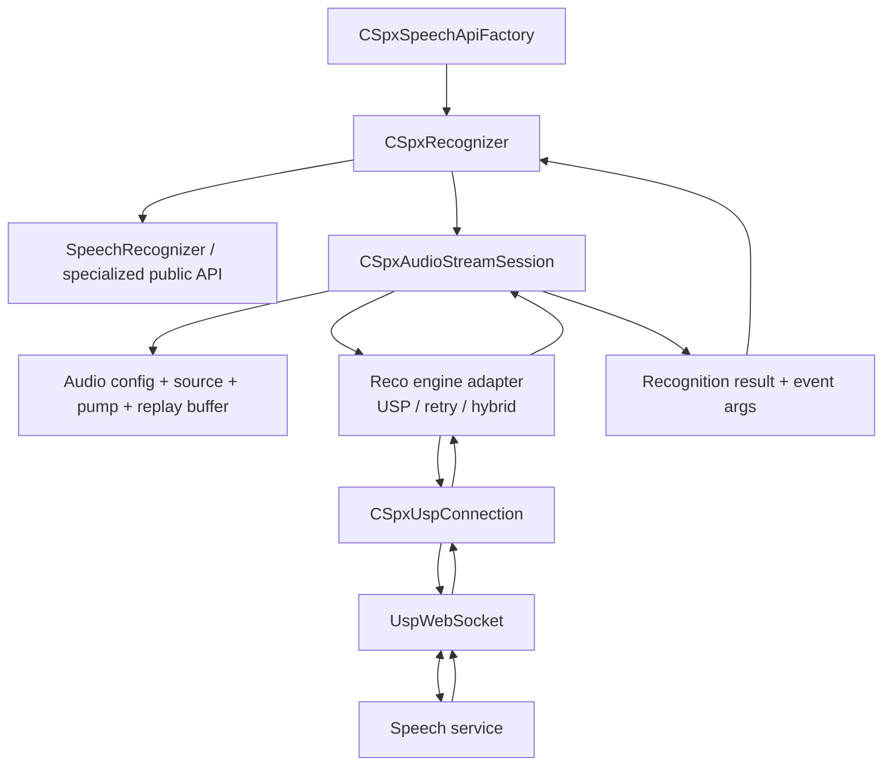
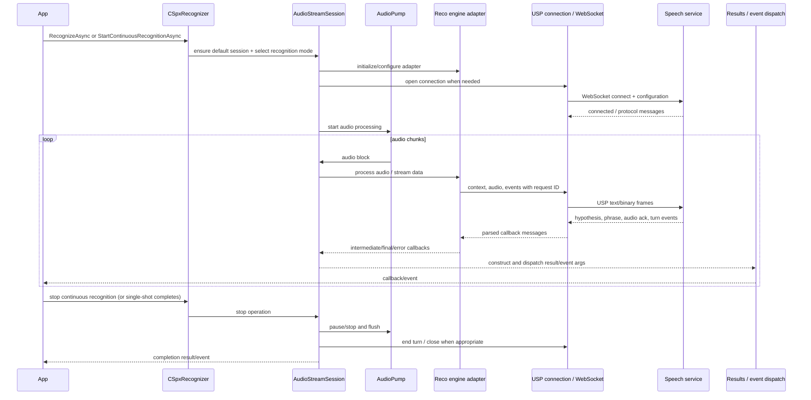
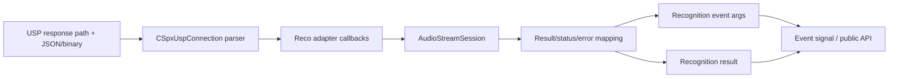

# 4. Speech recognition subsystem

## Role and components

Recognition orchestration centers on `source/core/sr`:

- `CSpxRecognizer` is the recognizer-facing façade. It configures mode/grammar, exposes one-shot/continuous/keyword operations, manages events, and delegates work to its default session.
- `CSpxAudioStreamSession` is the runtime coordinator. It owns or connects audio input, pump, replay/throttling state, thread services, a recognition engine adapter, and the result/event pipeline.
- `CSpxSpeechApiFactory` selects recognizer variants and initializes the session from audio config.
- `CSpxUspRecoEngineAdapter` adapts the recognition session to the USP connection callbacks/protocol. `hybrid_reco_engine_adapter` and retry helpers provide related adapter paths.
- Specialized classes include translation/source-language recognizers, conversation/meeting transcription, dialog connector, grammar/phrase lists, pronunciation assessment config, and embedded model descriptors.

The SDK source contains these code paths, but some features/platform capabilities depend on service support, build options, and extension packages. Consult the root README for the repository's feature limitations.

## Runtime topology

## Recognition sequence

The exact connection reuse and stopping behavior depends on single-shot versus continuous recognition and session state. The session has explicit start/stop/state management; it should not be reduced to a request-per-call HTTP model.

## Session responsibilities

`audio_stream_session.cpp` is the richest recognition entry point. Its method inventory shows responsibilities including:

- Initialize/terminate; create tasks and initialize audio from file, microphone, or stream.
- Establish audio format and process chunks; slow/throttle based on unacknowledged audio; process the next audio block.
- Add/remove recognizers and associate conversation/meeting state.
- Open/close network connection, wait for idle, send activities and custom network messages.
- One-shot, continuous, VAD and keyword recognition operations; start/stop and completion synchronization.
- Receive engine events: turn start/stop, intermediate/final results, speech start/end, errors, translation synthesis, activities and message events.
- Build event args/results; update latency; apply latency threshold/reconnect logic.
- Initialize/reset recognition, output and detection adapters; handle keyword detection and adapter hot swaps.
- Manage audio offsets, replay buffer, parameters, telemetry and token refresh.

## Results and event conversion

The adapter and USP layer parse service protocol messages into internal recognition/translation message types. The session maps these to SDK results with reason, text, offsets/duration, status, phrase/speaker/language metadata and cancellation/error details. `CSpxRecognizer::FireResultEvent` routes result reasons to final, intermediate, canceled, or translation-synthesis event signals. Event args are created through factories/services and dispatched to listeners.

## Specialized paths

- **Translation:** translation recognizer/config/result types augment recognition output with target language results and possibly synthesized translation audio.
- **Language ID:** source-language config and auto-detect config influence endpoint/request properties; auto-detect can be constrained to explicit languages or open-range paths depending on scenario.
- **Conversation/meeting transcription:** extra conversation, meeting, participant and transcriber objects; `meeting_transcriber` integration attaches to a meeting/session and uses participant metadata.
- **Keyword/VAD:** detection adapter/model integration can change session adapter behavior, start/stop paths and result reasons. `recognizer.cpp` routes VAD-enabled requests to dedicated session methods.
- **Grammar/phrase list:** recognizer stores grammar objects; `GetListenForList` collects terms and supplies phrase-list weight via properties.
- **Dialog service connector:** own public API and callbacks for activities, listening, keyword recognition and turn status; shares protocol/network foundation, but is not the ordinary speech recognizer API.

## Places to inspect

- `source/core/sr/recognizer.cpp` — operation dispatch, recognition mode rules, event forwarding.
- `source/core/sr/audio_stream_session.cpp` — session state and complete audio-to-results orchestration.
- `source/core/sr/speech_api_factory.cpp` — object creation/session setup.
- `source/core/sr/usp_reco_engine_adapter.cpp` and `usp_reco_engine_adapter_retry.cpp` — adapter-to-protocol bridge and retry behavior.
- `source/core/usp/usp_connection.cpp` — wire-message parsing and protocol state.
- `source/core/c_api/speechapi_c_factory.cpp` — public handle creation mapping.
