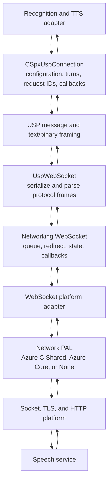
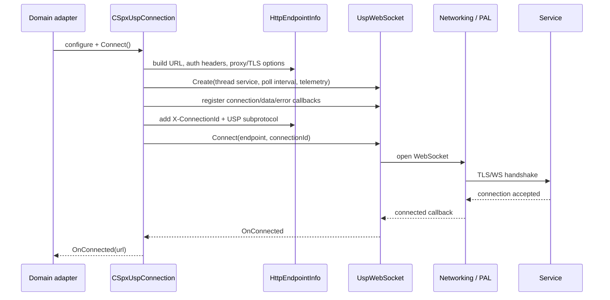
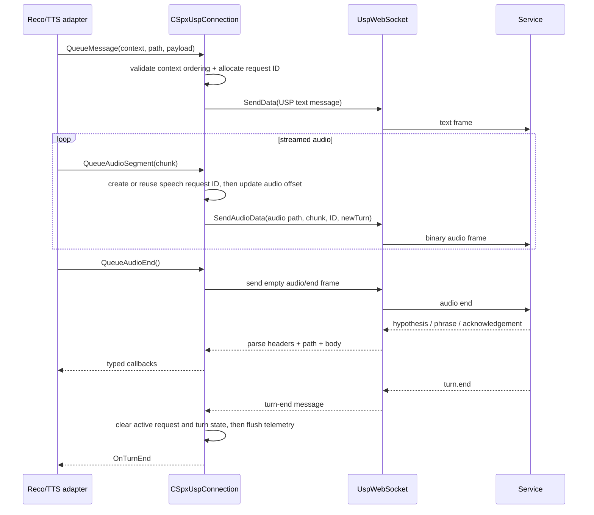

# 5. USP protocol and networking

## Separation of responsibilities

The transport stack is layered. Recognition/synthesis domain adapters form and consume domain operations; USP classes model protocol messages, IDs and turns; `UspWebSocket` frames and parses USP traffic over a generic WebSocket; the networking layer manages queues, endpoint, redirects, HTTP/WebSocket contracts and platform adapter selection; PAL implementations bind to the native platform or a vendored utility.

## Connection setup

`CSpxUspConnection::Connect` builds `HttpEndpointInfo` from client configuration: endpoint URL, endpoint type/region, authentication headers, audio response format, caller headers/options, proxy and TLS settings. It adds the USP WebSocket subprotocol and connection ID, creates a `UspWebSocket`, binds callbacks, and connects. The URL builder supports standard and custom endpoint/host shapes for speech, translation, dialog, transcription and synthesis endpoint types.

## Outgoing turns and request IDs

USP uses paths, headers and request IDs to correlate messages with service turns. `QueueMessage` enforces path validity and context-message ordering. `UpdateRequestId` differentiates configuration, agent context, speech context/events, generic events, SSML and binary messages. Audio messages use a current speech request ID; first audio marks a new turn, offsets advance as bytes are queued, and a zero-sized chunk flushes audio end. The code tracks active IDs and telemetry.

Important protocol invariants visible in `usp_connection.cpp`:

- A context message is allowed only once per turn and must precede audio for ordinary speech paths.
- Audio starts a turn and shares a speech request ID; audio end resets the audio offset and allows the next context.
- `speech.event` generally belongs to an active speech turn (with special behavior for the conversation transcriber endpoint).
- `turn.end` removes the active request ID, flushes telemetry, and resets per-turn state.
- Configuration messages are not tied to a request ID; other message types follow message-specific rules.

The wire-level framing is more nuanced than a single generic message: `UspWebSocket` has separate text and binary handling; binary audio may include a new-stream indicator, headers and payload data. See `usp_web_socket.cpp`, `usp_message.cpp`, `usp_text_message.cpp`, and `usp_binary_message.cpp`.

## Incoming data processing

`CSpxUspConnection::OnTransportData` validates required path and active request ID, forwards generic message callbacks, processes continuation headers, and parses binary or JSON text bodies. It dispatches typed callbacks for speech start/end, turn start/end, keyword, hypothesis/fragment/phrase, translation, audio chunks, audio metadata, synthesis end, audio start/end and user messages. Invalid protocol cases use protocol violation/error paths rather than silently treating all data as results.

`UspWebSocket` relays connected/disconnected/error, text and binary data and estimated upload rate to `CSpxUspConnection`; the connection in turn invokes callbacks held in its client configuration. The adapter callback boundary is how recognition and TTS remain separate from wire parsing.

## Networking and PAL

- `source/core/network/networking` — endpoint URL/config, HTTP utilities/errors, WebSocket adapter interface, delegate implementations, outbound queues and redirect/caching helpers.
- `source/core/network/pal` — chosen implementation module. CMake selects `Azure_C_Shared`, `Azure_Core`, or `None`; Azure C Shared may have static/dynamic OpenSSL variants.
- `source/core/external/azure-c-shared-utility` — vendored C networking utility with platform-specific socket/TLS/HTTP adapters and its own tests/docs.
- `source/core/interfaces/include/interfaces/i_http_endpoint_info.h`, `web_socket.h`, `ispx_usp_connection.h` — contracts across the layers.

The PAL selection is a build-time choice, not a runtime assumption. `None` can provide a no-network implementation suitable for builds that do not use network features. TLS validation, proxy behavior and platform support are delegated to endpoint/PAL implementations.

## Debugging pointers

1. Is domain logic failing to produce a message? Inspect `sr`/`tts_cloud` adapter first.
2. Is a path, header, request ID or turn invalid? Inspect `usp_connection.cpp` and message builders/utilities.
3. Is parsing wrong? Inspect `usp_web_socket.cpp`, USP header utilities and `OnTransportData`.
4. Is the socket not opening/sending? Inspect `network/networking` then the configured PAL and third-party adapter.
5. Is it a configuration issue? Trace config properties to `ClientConfiguration`, `HttpEndpointInfo`, proxy/TLS parse helpers, and target CMake options.
