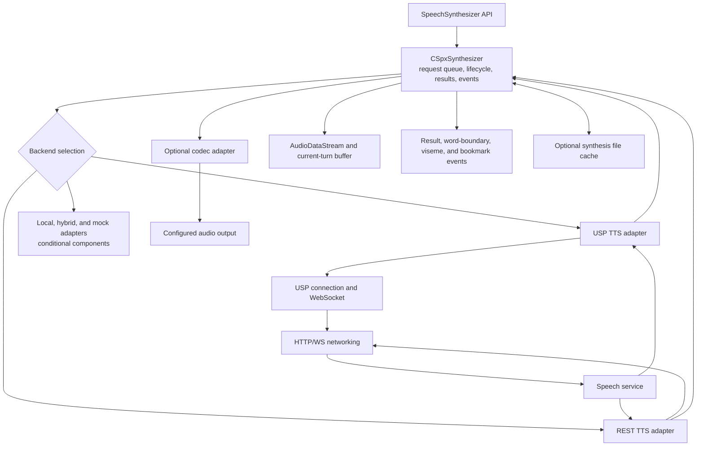
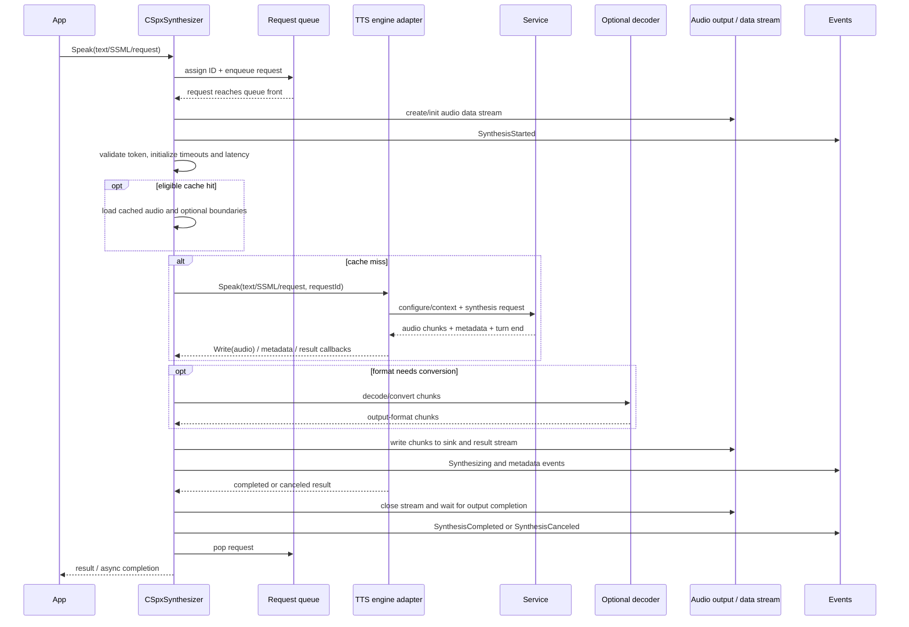

# 6. Speech synthesis subsystem

## Responsibilities

`source/core/tts` contains the synthesis orchestrator and result/event/voice/request models. `source/core/tts_cloud` supplies cloud engine adapters for USP WebSocket, REST, and shared cloud behavior. Optional local, hybrid, cache and mock modules may be provided through additional build components/extensions; do not assume those are all available in this source distribution.

`CSpxSynthesizer` coordinates requests, output format, token refresh, per-request queueing, engine callbacks, audio conversion/output, result construction, metadata delivery, optional caching and telemetry. The selected engine adapter owns the service/backend interaction and reports audio/metadata back through adapter callbacks.

## Component topology

## Speak request flow

Synthesis requests are serialized through a request queue. `Speak` assigns a request ID, enqueues and waits until it reaches the front, initializes an audio data stream and fires the synthesis-started event. `ExecuteSynthesis` refreshes/validates credentials if needed, starts timeouts/latency accounting, checks eligible cache paths, invokes the selected adapter, waits for stream decoding as applicable, finalizes result audio/properties and output, signals completion/cancellation, logs telemetry and removes the request from the queue.

For nonblocking start-speaking APIs, synthesis can continue on a worker/detached thread while the start result is returned. `SpeakAsync` instead wraps full speak completion in an async operation. These are different completion semantics.

## Backend selection

`CSpxSynthesizer::InitializeTtsEngineAdapter` branches on synthesis backend properties. The implementation outline shows offline/local, hybrid and mock named adapters plus REST and USP WebSocket paths. Default/endpoint/host properties are interpreted and endpoint checks can normalize token-service endpoints to a region. Backend availability is governed by linked modules and build configuration; adapter construction failure is surfaced as an SDK error.

- `CSpxUspTtsEngineAdapter` prepares USP client configuration, sends speech config/context and SSML or streamed text pieces, then handles audio output chunks/metadata/turn end/errors.
- `CSpxRestTtsEngineAdapter` handles REST-backed synthesis.
- Shared `CloudTtsEngineAdapter` provides common cloud behavior.
- Local/hybrid and mock implementations live in separate/conditional modules.

## Audio and events

Adapter audio is routed through `CSpxSynthesizer::Write`. The synthesizer checks request ID and stop state. If source and requested audio formats differ it sets up a codec with callback-connected intermediate buffers; otherwise it writes directly. `WriteToOutput` emits incremental synthesis results, writes to current-turn buffer/data stream/output, tracks latency and underruns, and coordinates playback-buffer start.

Word boundaries, visemes and bookmarks are offset-based. When synchronization-to-audio is enabled and a render device is available, events are delayed until playback reaches a corresponding offset. Event dispatch uses a dedicated callback thread service and affinity classes. At metadata end, the synthesizer waits (with timeout) for metadata dispatch before completion delivery, using a latch.

## Stop, queue, timeout, and lifetime

- Stop clears queued requests while preserving the active front request, asks the adapter to stop, clears buffered audio, waits for decode/output coordination and then resets the stop state.
- Timeout management monitors synthesis/audio progress and can ask the adapter to stop.
- `Term` shuts down worker and event-dispatch thread services before destroying the adapter and state those workers can call. This order is an explicit lifetime-safety invariant; preserve it when editing teardown.
- Token refresh bridges a token request event/provider to the token properties. Comments note this applies to both USP and REST adapters.
- Optional caching is primarily enabled by configured cache path/capacity and eligible requests; code records online WebSocket raw audio and word-boundary metadata, while offline synthesis and text-stream mode are treated differently.

## Code landmarks

- Orchestrator: `source/core/tts/synthesizer.cpp` and `synthesizer.h`.
- Factories: `source/core/tts/speech_synthesis_api_factory.cpp`.
- USP backend: `source/core/tts_cloud/usp_tts_engine_adapter.cpp`.
- REST/cloud: `source/core/tts_cloud/rest_tts_engine_adapter.cpp`, `cloud_tts_engine_adapter.cpp`.
- Request/result/events: `tts/synthesis_request.*`, `synthesis_result.*`, `synthesis_event_args.*`, metadata event argument classes.
- Format/SSML: `source/core/common/include/synthesis_helper.h`.
- Public API: `source/public/cxx_api/speechapi_cxx_speech_synthesizer.h` and related synthesis request/result/event headers.
