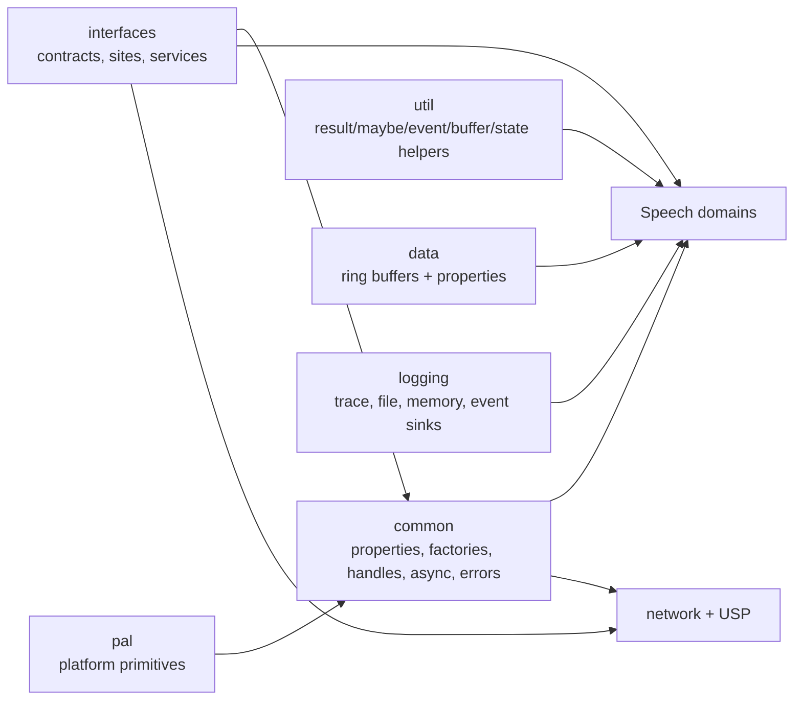

# 7. Shared core services

Speech-specific components depend on a shared native runtime. These libraries provide contracts and reusable infrastructure, not a single monolithic service.

## Interfaces and composition

`source/core/interfaces` is primarily an interface target. It defines object/site/service contracts, result/audio/network/recognizer types, WebSocket/HTTP endpoint interfaces, telemetry and other boundaries. Components query interfaces and services using common helpers rather than requiring all concrete classes to depend directly on one another.

`source/core/common` implements reusable patterns: named properties, object creation/module loading, shared-pointer and handle helpers, errors/exceptions, async operations, thread service, file/string/time utilities, audio source delegate implementations, and platform/runtime helpers.

## Threading and async operations

- `CSpxThreadService` provides managed task execution, affinities, cancellation and thread identity checks.
- `asyncop.h` / `async_helpers.h` wrap futures/promises in SDK operation semantics and synchronous wait adapters.
- `task_helpers.h` provides sync-on-thread, async and delayed task utilities, plus a countdown latch.
- Domain objects can use multiple services for different work: audio/media processing, background tasks, user-facing event callbacks. Their termination sequence must stop/join/cancel work before freeing objects captured by queued tasks.

When tracing a callback, follow not only direct function calls but also the queue/service submit and dispatch boundaries. A result callback can arrive on an affinity-specific worker rather than the initiating thread.

## Properties and object factories

Named property bags are central configuration transport. `property_bag_impl.h/.cpp`, `named_properties.h`, property ID/name maps and `service_provider_impl.h` implement storage, inheritance/copy and querying. Root/factory/site patterns allow children to obtain parent properties and common services.

`module_factory` and `factory_helpers` use module object creation boundaries. `dynamic_module` supports runtime library loading where configured; `factory_speech` assembles speech-domain components. Build-time selection can replace implementations according to platform or feature.

## Errors, results and exceptions

- `ErrorInfo` normalizes explicit runtime errors, HTTP status, WebSocket errors, recognition status and appended details.
- `ExceptionWithCallStack` and throw helpers attach SDK status/callstack information.
- `try_catch_helpers.h` and `SPXAPI_*` macros protect C ABI functions, where exceptions cannot cross the C boundary.
- Domain result objects store reason/status/audio/text/properties and cancellation details.

Keep status conversion consistent when adding a new failure path. Transport/protocol errors, recognition cancellations, output sink errors and API argument validation are distinct categories.

## Logging and telemetry

`source/core/logging` supplies trace messages, console/file/event-source/event/memory loggers and fatal exit monitoring. `common` and domain layers call trace helpers; public logging classes are wrappers where exposed.

USP telemetry is tied to request IDs and records transport connection, audio lifecycle, received messages, latency, errors and flush events. The connection checks `SPEECH-TelemetryDataEnabled` before sending telemetry. Synthesis has separate event telemetry and may honor its own settings. The root README describes how to disable SDK telemetry and gives its recommendation; see that disclosure before making claims about collection.

## JSON, protocol types and utilities

- `source/core/json/ajv` implements JSON builder/parser/reader/view abstractions used by protocol and configuration parsing.
- `source/core/network/types` and `source/core/network/util` define network/USP messages and header/message utilities.
- `source/core/util` is a small header-only collection: `Maybe`, `Either`, `Result`, event, buffer, JSON serializable, scope guard, state machine, promise helpers and traits.
- `source/core/pal` abstracts low-level platform functions such as GUIDs, environment and helper functions; `source/core/network/pal` specifically selects networking implementation.

## Vendored dependencies

`source/core/external/azure-c-shared-utility` contains the Azure C shared utility, its platform adapters (sockets, TLS, HTTP, thread/time primitives), unit tests, and upstream developer requirements/porting docs. Treat it as a dependency boundary: SDK-specific transport configuration lives in `source/core/network`; the vendored C implementation provides low-level operations.

## Module guide

| Directory | Short purpose |
|---|---|
| `source/core/interfaces` | Cross-component C++ contracts and site/service patterns |
| `source/core/common` | Runtime helpers, properties, thread service, errors, handles, factories |
| `source/core/util` | Header-only generic utilities |
| `source/core/data` | Ring buffers and buffer property storage |
| `source/core/logging` | Logging and diagnostics sinks |
| `source/core/json` | JSON parser/builders used internally |
| `source/core/pal` | Platform-specific core primitives |
| `source/core/libcarbon` | Library entry/runtime integration |
| `source/core/mock`, `tts_mock` | Test/mock adapters when included by build |
