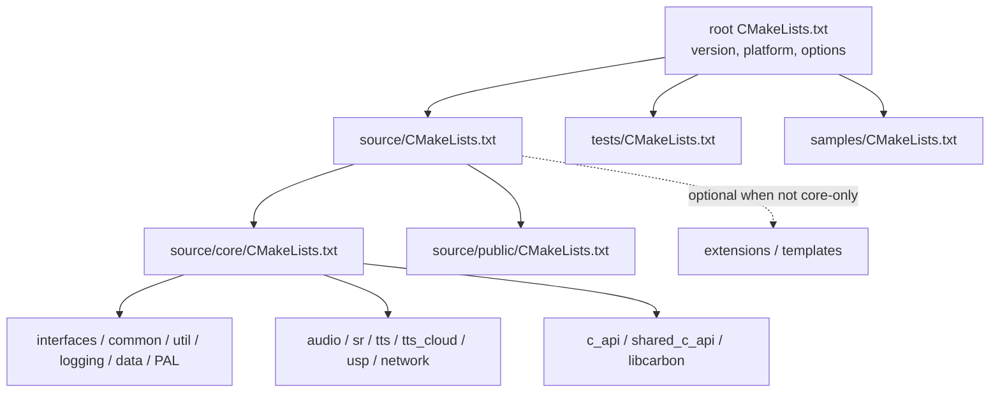

# 8. Build, tests, and repository map

## Build composition

The project uses CMake. The root file establishes platform/version configuration and core-only build behavior; `source/CMakeLists.txt` conditionally adds extension/template areas and always adds core/public; `source/core/CMakeLists.txt` adds individual modules. CMake target dependencies are the source of truth for the selected configuration.

Root options include core-only mode, platform selection and network implementation selection. Depending on environment, platform, compiler and third-party dependencies, available targets differ. Look at `.github/workflows/cmake-multi-platform.yml` for CI's platform matrix and configure flow.

### CMake entry points

- Root `CMakeLists.txt`: minimum CMake, build mode detection, platform/version parsing and global configuration.
- `source/CMakeLists.txt`: conditionally extensions/templates; then core and public.
- `source/core/CMakeLists.txt`: module subdirectories.
- `source/core/network/pal/CMakeLists.txt`: selection of Azure C Shared / Azure Core / None networking.
- Module CMakeLists: source lists, conditional platform codec sources and link dependencies.

## Tests and samples

The root test build is controlled by `BUILD_TESTS`. The tests CMake adds common test support, C++ core functional tests, and optionally unit/API/C#/Java tests according to available source and build flags. External Azure C shared utility brings its own low-level unit tests. The top-level tests are not one single monolithic executable.

- `tests/functional/cxx/core` — core C++ behavior tests.
- `tests/functional/cxx/api` — API-focused tests in non-core-only configurations.
- `tests/unit-tests` — conditionally included native unit tests.
- `tests/functional/csharp` and Java paths — conditional language test trees; do not infer supported public API bindings from their mere presence.
- `samples/sdkdemo` — sample application using an installed/vcpkg SDK, rather than directly compiling core source as its own SDK.
- `tests/input` and `samples/data` — test/sample assets.

## Repository map

| Path | Why it matters |
|---|---|
| `README.md` | Product/source limitations, build platform workflow, telemetry, versioning |
| `source/public/cxx_api` | Public C++ SDK declarations |
| `source/public/c_api` | Public C declarations |
| `source/core/c_api` | C ABI implementations, handles, events, factories |
| `source/core/shared_c_api` | Shared C ABI helpers and conversions |
| `source/core/interfaces` | Domain and infrastructure interfaces |
| `source/core/factory`, `factory_speech` | General and speech-specific object creation |
| `source/core/audio`, `data` | Audio data plane |
| `source/core/sr` | Recognition/session orchestration and related speech domains |
| `source/core/tts`, `tts_cloud` | Synthesis and cloud backends |
| `source/core/usp` | Unified Speech Protocol connection/messages |
| `source/core/network` | HTTP/WebSocket abstractions and platform network implementations |
| `source/core/common`, `util`, `logging`, `pal` | Shared runtime infrastructure |
| `source/core/json` | Internal JSON support |
| `source/core/external` | Vendored low-level dependencies |
| `tests`, `samples`, `.github/workflows` | Validation, usage example, build automation |

## Suggested investigation recipes

### Find a public feature implementation

1. Search `source/public/cxx_api` for the public class/method.
2. Locate its implementation or interface in `source/core/interfaces` and `source/core/{sr,tts,audio}`.
3. Trace creation in `speechapi_c_factory.cpp` and domain factory files.
4. Inspect events/results and matching tests.

### Trace a recognition protocol response

Start at `source/core/usp/usp_connection.cpp` `OnTransportData`, then follow the typed callback into `usp_reco_engine_adapter.cpp`, `audio_stream_session.cpp`, and `recognizer.cpp` event/result creation.

### Trace audio bytes

For input: `audio_stream_session.cpp` source initialization and `StartAudioPump` -> `audio_pump.cpp` -> reader/source implementations -> adapter processing. For synthesis output: `tts/synthesizer.cpp` `Write`, codec callbacks and `WriteToOutput` -> selected audio sink.

### Trace a synthesis request

Start at `tts/synthesizer.cpp` `Speak`/`ExecuteSynthesis` and `InitializeTtsEngineAdapter`; follow USP requests into `tts_cloud/usp_tts_engine_adapter.cpp` and `usp/usp_connection.cpp`, or follow REST into `rest_tts_engine_adapter.cpp`.

### Analyze code structurally

Useful `AnalyzeCode` invocations:

- `outline source/core/sr/audio_stream_session.cpp --depth 2 --show-signatures`
- `outline source/core/tts/synthesizer.cpp --depth 2 --show-signatures`
- `outline source/core/usp/usp_connection.cpp --depth 2 --show-signatures`
- `outline source/core/c_api/speechapi_c_factory.cpp --depth 2 --show-signatures`
- `count methods source/core/sr/ --by file`

## Glossary

- **PAL:** platform abstraction layer; networking PAL selects a concrete HTTP/WebSocket transport implementation.
- **Site:** object composition/service-provider context used to find parent properties and shared services.
- **USP:** protocol layer that carries typed speech/synthesis operations over WebSocket transport.
- **Audio pump:** worker that reads audio blocks and delivers them to processing callbacks.
- **Request ID / turn:** protocol correlation identity used to associate messages/audio/results with a request or service interaction.
- **Handle table:** typed mapping from opaque C API handles to shared internal C++ objects.
- **Core-only:** build mode that excludes additional extensions/templates and other conditional components; it does not mean all features described by the full product are present.
