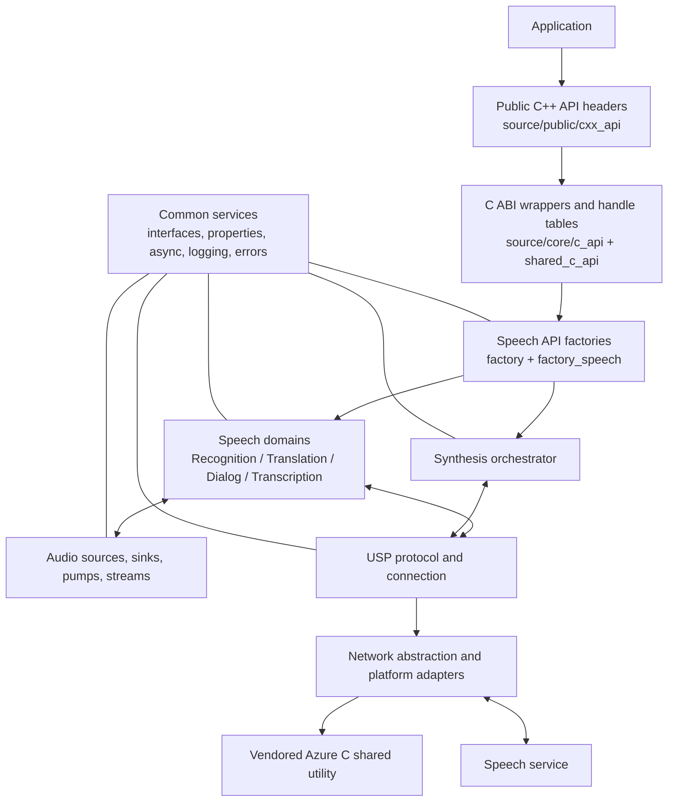

# Speech SDK source tour

This directory is a source-oriented architecture guide. It was assembled by inspecting the repository structure, CMake target graph, public headers, and implementation outlines with `AnalyzeCode`. It is a map to the code, not a replacement for the public API documentation.

> **Repository identity and scope:** this is the native Azure Speech SDK source repository, not a C# CLI. The project is predominantly C and C++. The root README says the open-source offering exposes C++ source/API support and excludes official extension packages and several extension-dependent capabilities. There are C API headers and implementation wrappers in the tree; their presence should not be confused with a promise that all published SDK language bindings/features are supported from this source distribution.

## Reading order

1. [System architecture](01-system-architecture.md) — module boundaries, composition, and a top-level diagram.
2. [API boundary and object lifecycle](02-api-and-lifecycle.md) — public C++ surface, C ABI bridge, handles, factories, properties, and events.
3. [Audio subsystem](03-audio.md) — input/output streams, pumps, buffers, and recognition audio path.
4. [Speech recognition](04-recognition.md) — recognizer, session, engine adapter, event/result flow.
5. [USP and networking](05-usp-and-networking.md) — wire protocol, WebSocket layers, connection/message handling.
6. [Speech synthesis](06-synthesis.md) — synthesis orchestration, cloud adapter selection, streaming output/events/cache.
7. [Shared core services](07-shared-services.md) — interfaces, factories, platform abstraction, async/threading, logging, JSON, and data buffers.
8. [Build, tests, and repository map](08-build-tests-and-map.md) — CMake, platform variants, tests, samples, and where to look next.

## Architecture at a glance

## How to use this guide

- Paths refer to repository-relative paths from the root.
- Mermaid diagrams are conceptual: they show logical calls/data flow, not exact thread scheduling or every adapter implementation.
- Feature availability can depend on platform, build options, and extension packages. Read [the root README](../README.md) before inferring product support from code presence.
- Third-party code under `source/core/external/azure-c-shared-utility` is included as a transport/runtime dependency; it is not the SDK's speech-domain implementation.
- To inspect declarations and concrete call paths, use the source links in each document alongside `AnalyzeCode outline` for that file/module.
